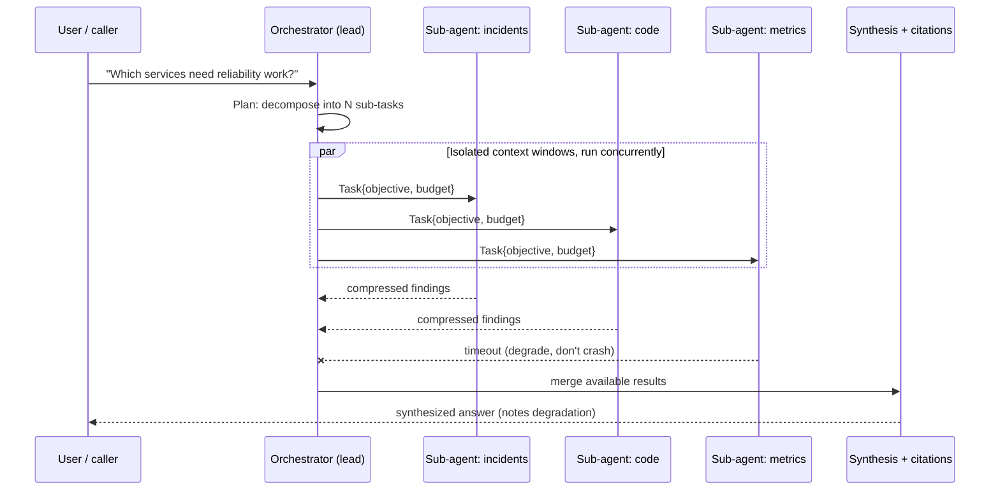

# Designing a Multi-Agent Backend: The Orchestrator Pattern

> Источник: <https://backendbytes.com/articles/multi-agent-orchestrator-backend/>
> **One agent, one loop, 180K tokens — and a confident answer about 3 services that silently ignored the other 37.**
> Picture an agent asked to "audit last quarter's incidents." It reads the tracker, the Git history, the metrics, the runbooks — sequentially, into one conversation — until it hits the context limit mid-synthesis and drops most of what it read. Nothing in that run is a bug. The architecture is the problem.

The fix is the **orchestrator pattern**: decompose the work, fan it out to specialized **sub-agents** with **isolated context windows**, synthesize the results. This article builds that orchestrator in Go — every snippet ran through `go build`, `go vet`, and `go test -race` — plus the failure handling, cost control, and observability that separate a demo from a production system.

TL;DR

A single agent breaks down on three axes: **context-window saturation** (everything lands in one window), **serial latency** (tools run one after another), and **tangled responsibilities** (one prompt does everything badly).

- **Orchestrator/sub-agent pattern**: a coordinator decomposes the task, spawns specialized sub-agents that run *concurrently* with *isolated* contexts, then merges their outputs. Each sub-agent compresses a slice of the problem before it ever reaches the coordinator's window.
- **Failure handling is the hard part**: per-sub-agent timeouts, graceful degradation on partial failure, idempotent retries, and a hard token-budget cap — not the happy-path fan-out.
- **It is often overkill**: if the work is sequential, fits one context window, or shares state across steps, a single agent or a fixed pipeline is cheaper and easier to debug. Multi-agent systems in Anthropic's own data burned **~15× the tokens of a chat**.

The reference orchestrator below is self-contained Go (`errgroup` + stdlib), race-tested, and degrades to a partial answer when sub-agents time out or error.

## [Why now: the shift from assistants to agent teams](#why-now-the-shift-from-assistants-to-agent-teams)

Anthropic's *2026 Agentic Coding Trends Report* names this Trend 2 — *"Single agents evolve into coordinated teams"* — and its Societal Impacts research quantifies the orchestration surface: developers *"use AI in roughly 60% of their work"* but can *"fully delegate only 0–20% of tasks"* ⁠[[1]](https://resources.anthropic.com/hubfs/2026%20Agentic%20Coding%20Trends%20Report.pdf "2026 Agentic Coding Trends Report — Anthropic (2026), Anthropic"); the gap is work done under human direction.

The Go side landed in late 2025: the official **Go MCP SDK v1.0.0** (with a no-breaking-changes guarantee⁠[[2]](https://github.com/modelcontextprotocol/go-sdk/releases/tag/v1.0.0 "Model Context Protocol Go SDK — v1.0.0 release notes — Model Context Protocol maintainers (2025), GitHub")) and Google's **ADK for Go** built on it⁠[[3]](https://go.dev/blog/16years "Sixteen years of Go — The Go Team (2025), go.dev"). You need neither to understand the pattern — the orchestrator is a concurrency problem, and the pattern builds on `errgroup`⁠[[4]](https://pkg.go.dev/golang.org/x/sync/errgroup "errgroup — synchronization, error propagation and Context cancelation for groups of goroutines — The Go Authors (2025), pkg.go.dev") and the standard library, noting where MCP and ADK slot in.

## [Where the single agent actually breaks](#where-the-single-agent-actually-breaks)

Before reaching for an orchestrator, be precise about *which* limit you are hitting. There are three, and they fail differently.

### [1. Context-window saturation](#1-context-window-saturation)

A single agent appends every tool result to one conversation. Read ten files, query three databases, fetch five web pages, and the window fills with raw material the model must re-read on every turn. Anthropic's research team put the mechanism plainly: *"The essence of search is compression: distilling insights from a vast corpus. Subagents facilitate compression by operating in parallel with their own context windows, exploring different aspects of the question simultaneously before condensing the most important tokens for the lead research agent."* ⁠[[5]](https://www.anthropic.com/engineering/multi-agent-research-system "How we built our multi-agent research system — Anthropic (2025), Anthropic Engineering")

When the window overflows, the agent silently truncates — and you get the scenario from the top of this article. The 200K-token windows common in 2026 models push the wall further out, but they do not move it.

### [2. Serial latency](#2-serial-latency)

A single agent's tool calls are a serial chain: query, wait, read result, decide next query, wait again. For a task that touches forty independent services, that chain is forty round-trips deep. Anthropic measured the effect of parallelizing it: introducing fan-out so *"the lead agent spins up 3–5 subagents in parallel rather than serially"* and letting *"subagents use 3+ tools in parallel"* — *"cut research time by up to 90% for complex queries"* ⁠[[5]](https://www.anthropic.com/engineering/multi-agent-research-system "How we built our multi-agent research system — Anthropic (2025), Anthropic Engineering"). Parallelism is not a micro-optimization here; it is the difference between an answer in two minutes and an answer in twenty.

#### Orchestration Concurrency & Latency Simulator

Compare Execution Models

Sub-agents (Tasks)4

Avg LLM Latency3.5s

Jitter / Variance1.2s

Serial Agent Loop (Single Context)13.77 seconds

3.5s

4.69s

3.19s

2.39s

Orchestrated Fan-out (Parallel)5.09 seconds

Fan-out Subtasks (Slowest: 4.69s)+0.4s overhead

Latency Saved63% Faster-8.68s saved

Context BloomSerial: ~100K tokensParallel: ~12.8K tokens

### [3. Tangled responsibilities](#3-tangled-responsibilities)

A single system prompt that must read Git history, query metrics, and parse YAML runbooks is a prompt that does each one worse than a focused prompt would. Worse, the *outputs* contaminate each other: a verbose runbook dump crowds out the metrics the model needed two turns later. Specialized sub-agents give you *separation of concerns* — Anthropic again: each sub-agent provides *"distinct tools, prompts, and exploration trajectories — which reduces path dependency and enables thorough, independent investigations."*

| Limit | Symptom in production | What the orchestrator changes |
| --- | --- | --- |
| Context saturation | Silent truncation, dropped findings, confident-but-incomplete answers | Each sub-agent gets its own window; only compressed results reach the coordinator |
| Serial latency | p95 latency grows linearly with number of sources | Independent sub-tasks run concurrently; latency tracks the *slowest* branch, not the sum |
| Tangled responsibilities | One prompt is mediocre at every sub-task; outputs interfere | One specialized prompt + toolset per sub-agent |

**Takeaway:** name the limit before you reach for the pattern. If you are not hitting context, latency, *or* responsibility limits, you do not have a multi-agent problem yet.

## [The orchestrator pattern, precisely](#the-orchestrator-pattern-precisely)

The shape is an **orchestrator-worker** topology: a lead agent (the orchestrator) owns the user-facing task and the plan; specialized sub-agents (workers) own slices of it. Anthropic describes its production Research system in exactly these terms: *"a multi-agent architecture with an orchestrator-worker pattern, where a lead agent coordinates the process while delegating to specialized subagents that operate in parallel."*



Four mechanics make it work, and each has a failure mode if you skip it:

1. **Context isolation.** Each sub-agent runs with its own context window, tools, and prompt. This is the whole point: a sub-agent reading 50K tokens of Git history returns a 2K-token summary, and the orchestrator never sees the 50K. Skip it and you have rebuilt the single-agent wall with extra steps.
2. **Parallel fan-out.** Sub-agents with no dependency between them run concurrently. Skip it and you have paid the coordination cost of multi-agent for the latency of single-agent.
3. **Result synthesis.** The orchestrator merges sub-agent outputs into one answer — often by re-prompting a model with the collected summaries, and frequently with a separate citation pass. Skip it and you have a pile of disconnected fragments.
4. **Failure handling.** Sub-agents time out, hit rate limits, and return garbage. The orchestrator must degrade to a partial answer rather than crash. This is the part demos skip and production cannot.

The rest of this article builds those four, in Go, with the failure handling first-class rather than bolted on.

**Takeaway:** orchestrator-worker is the canonical topology. The orchestrator owns the plan and the synthesis; sub-agents own isolated slices. The value is in the isolation and the failure handling, not the fan-out itself.

## [Building the orchestrator in Go](#building-the-orchestrator-in-go)

We will model the coordinator as a concurrency problem and leave the LLM behind an interface, so the orchestrator is testable without a model in the loop. In production, a sub-agent's `Run` wraps an LLM client plus a set of MCP tools (via the Go MCP SDK); here it is an interface.

Start with the contracts. Keeping them small is what stops sub-agents from duplicating work — Anthropic found that vague instructions caused *"one subagent [to explore] the 2021 automotive chip crisis while 2 others duplicated work investigating current 2025 supply chains."* Each sub-task carries an objective and a hard token ceiling, nothing more.

```go
// Task is a unit of work the orchestrator hands to one sub-agent. Keeping the
// contract small and explicit is what stops sub-agents from duplicating work:
// each gets an objective and a hard token ceiling, nothing more.
type Task struct {
	AgentID   string // which specialized sub-agent runs this
	Objective string // the decomposed sub-question
	MaxTokens int    // per-agent budget cap, enforced by the agent
}
 
// Result is what a sub-agent returns. Tokens is the actual spend, used for
// budget accounting and cost observability. It deliberately carries no error:
// failures travel as a separate value so a slow or broken sub-agent never
// poisons the successful ones.
type Result struct {
	AgentID string
	Content string
	Tokens  int
	Latency time.Duration
}
 
// Agent is the sub-agent contract. A real implementation wraps an LLM client
// (e.g. the Anthropic or OpenAI SDK) plus a set of MCP tools; here we keep it
// behind an interface so the orchestrator is testable without a model in the
// loop. Run MUST honor ctx cancellation — that is how the orchestrator enforces
// per-agent timeouts and caller shutdown — and MUST stop at t.MaxTokens. Run
// MUST also populate Result.Tokens with actual usage even when it returns a
// non-nil error, so the orchestrator can reconcile the budget to real spend
// instead of refunding tokens the agent already burned.
type Agent interface {
	ID() string
	Run(ctx context.Context, t Task) (Result, error)
}
```

The single most important decision is in the `Result` and `Agent` contracts: **a sub-agent's failure is a value, not a returned error that unwinds the whole run.** That choice drives the rest of the design.

### [Configuration: budgets are not optional](#configuration-budgets-are-not-optional)

```go
// Config tunes the fan-out. Defaults mirror the shape Anthropic reported for
// Claude's Research system: a lead agent spinning up roughly 3-5 sub-agents in
// parallel, each with its own context window.
type Config struct {
	MaxConcurrent int           // bound on simultaneously-running sub-agents
	AgentTimeout  time.Duration // hard deadline per sub-agent
	TokenBudget   int           // global ceiling across the whole fan-out
}
 
func (c Config) withDefaults() Config {
	if c.MaxConcurrent <= 0 {
		c.MaxConcurrent = 4
	}
	if c.AgentTimeout <= 0 {
		c.AgentTimeout = 30 * time.Second
	}
	if c.TokenBudget <= 0 {
		c.TokenBudget = 200_000
	}
	return c
}
```

The defaults are deliberate. `MaxConcurrent: 4` reflects the 3–5 sub-agent fan-out Anthropic reported. The `TokenBudget` is the cost circuit breaker — multi-agent systems *"burn through tokens fast,"* and an uncapped fan-out is an unbounded bill. We enforce it below, and getting the enforcement right turns out to be subtle.

### [The fan-out: errgroup with bounded concurrency](#the-fan-out-errgroup-with-bounded-concurrency)

`golang.org/x/sync/errgroup` gives us exactly the two primitives we need: bounded concurrency via `SetLimit`, and a derived `context.Context` that cancels when the parent does. The signatures are stable: `WithContext(ctx) (*Group, context.Context)`, `(*Group).SetLimit(n int)`, `(*Group).Go(func() error)`, `(*Group).Wait() error` ([golang.org/x/sync/errgroup](https://pkg.go.dev/golang.org/x/sync/errgroup)).

The non-obvious part: **we never return a sub-agent's error from the `g.Go` closure.** errgroup's contract is that *"the first goroutine in the group that returns a non-nil error will cancel the associated Context"* — which would kill every sibling sub-agent. In a multi-agent fan-out, one sub-agent failing is the *expected* case, not a reason to abort the others. So sub-agent failures are recorded into a slice; the closure returns `nil` for them unless the caller's `ctx` is done; and a non-nil error from `Wait()` means only one thing: the *parent* context was cancelled (deadline or shutdown), which genuinely is terminal.

```go
// Dispatch fans the plan out to sub-agents concurrently and synthesizes the
// results. The parent ctx governs the whole run; each sub-agent additionally
// gets its own derived context with a hard timeout. A failing sub-agent is
// recorded, not propagated — Dispatch only returns a terminal error when the
// caller's context is cancelled or no sub-agent produced anything usable.
func (o *Orchestrator) Dispatch(ctx context.Context, plan []Task) (RunReport, error) {
	start := time.Now()
 
	g, gctx := errgroup.WithContext(ctx)
	g.SetLimit(o.cfg.MaxConcurrent)
 
	var (
		mu       sync.Mutex
		results  []Result
		failures []AgentFailure
		reserved atomic.Int64 // worst-case tokens committed by in-flight sub-agents
		spent    atomic.Int64 // tokens actually consumed by successful sub-agents
	)
 
	recordFailure := func(id string, err error) {
		mu.Lock()
		failures = append(failures, AgentFailure{id, err})
		mu.Unlock()
	}
 
	for _, task := range plan {
		task := task // capture for the closure (harmless on Go 1.22+, explicit for clarity)
 
		g.Go(func() error {
			agent, ok := o.agents[task.AgentID]
			if !ok {
				recordFailure(task.AgentID, errors.New("no such agent registered"))
				return nil
			}
 
			// Global budget gate. The check MUST run inside the worker and
			// reserve atomically: a check in the dispatch loop would read a
			// stale total, because every goroutine sees reserved==0 before any
			// of them has started spending. reserveBudget does an atomic
			// compare-and-add so N concurrent sub-agents can't collectively
			// overshoot the ceiling.
			if !o.reserveBudget(&reserved, task.MaxTokens) {
				recordFailure(task.AgentID,
					fmt.Errorf("skipped: token budget %d would be exceeded", o.cfg.TokenBudget))
				return nil
			}
 
			// Context isolation: each sub-agent runs under its OWN deadline,
			// derived from the group context so a parent cancel still propagates.
			actx, cancel := context.WithTimeout(gctx, o.cfg.AgentTimeout)
			defer cancel()
 
			res, err := agent.Run(actx, task)
			if err != nil {
				// Degrade gracefully: reconcile down to what the agent actually
				// spent before it failed (not a blind full refund), log,
				// record, and keep the siblings alive.
				reserved.Add(int64(res.Tokens - task.MaxTokens))
				spent.Add(int64(res.Tokens))
				o.log.WarnContext(actx, "sub-agent failed",
					slog.String("agent", task.AgentID), slog.Any("err", err))
				recordFailure(task.AgentID, err)
				if ctx.Err() != nil {
					// The caller's context is gone: that is terminal for the
					// whole run, so surface it through Wait.
					return ctx.Err()
				}
				return nil
			}
 
			// Reconcile the worst-case reservation down to actual usage, and
			// record the real spend for cost observability.
			reserved.Add(int64(res.Tokens - task.MaxTokens))
			spent.Add(int64(res.Tokens))
			mu.Lock()
			results = append(results, res)
			mu.Unlock()
			return nil
		})
	}
 
	// Wait only surfaces an error if a Go func returned one — and ours return
	// one only when the parent context was cancelled (deadline/shutdown), which
	// is genuinely terminal.
	if err := g.Wait(); err != nil {
		// Every goroutine has finished once Wait returns, so results/failures
		// are safe to read here without the mutex — return what was gathered
		// before cancellation rather than discarding it.
		return RunReport{
			Results:     results,
			Failures:    failures,
			TokensSpent: int(spent.Load()),
			Elapsed:     time.Since(start),
		}, fmt.Errorf("dispatch cancelled: %w", err)
	}
 
	if len(results) == 0 {
		return RunReport{
			Failures:    failures,
			TokensSpent: int(spent.Load()),
			Elapsed:     time.Since(start),
		}, fmt.Errorf("all %d sub-agents failed", len(plan))
	}
 
	// Deterministic merge order keeps synthesis (and golden tests) stable even
	// though sub-agents finish in nondeterministic order.
	sort.Slice(results, func(i, j int) bool { return results[i].AgentID < results[j].AgentID })
 
	return RunReport{
		Synthesis:   o.synthesize(results, failures),
		Results:     results,
		Failures:    failures,
		TokensSpent: int(spent.Load()),
		Elapsed:     time.Since(start),
	}, nil
}
```

### [The budget bug you will write the first time](#the-budget-bug-you-will-write-the-first-time)

The budget cap looks like it belongs in the dispatch loop: before spawning a sub-agent, check whether its `MaxTokens` would blow the ceiling. That is wrong, and a concurrent test that asserts total spend catches it immediately. In the dispatch loop, every iteration reads `reserved == 0`, because the goroutines that *spend* the budget have not run yet — the loop is scheduling them, not waiting on them. All N sub-agents pass the gate, then all N spend. The cap does nothing.

The fix is to make the gate run *inside* the worker and reserve atomically, so concurrent sub-agents cannot collectively overshoot. A compare-and-swap loop does it:

```go
// reserveBudget atomically commits maxTokens against the global ceiling, or
// reports false if it would overshoot. The compare-and-swap loop is what makes
// the cap correct under concurrent fan-out: without it, two sub-agents could
// both read "budget available" and then both spend, busting the cap.
func (o *Orchestrator) reserveBudget(reserved *atomic.Int64, maxTokens int) bool {
	for {
		cur := reserved.Load()
		if int(cur)+maxTokens > o.cfg.TokenBudget {
			return false
		}
		if reserved.CompareAndSwap(cur, cur+int64(maxTokens)) {
			return true
		}
		// CAS lost a race; another sub-agent reserved first. Retry with the
		// fresh total.
	}
}
```

The pattern is *reserve worst-case, reconcile to actual*: a sub-agent reserves its `MaxTokens` before running, then — whether it succeeds or fails — reconciles the reservation down to what it actually spent (`res.Tokens`), rather than blindly refunding the whole ceiling on failure. This keeps the live ceiling honest whether sub-agents finish, fail, or get skipped, provided each agent stops at its own `MaxTokens` and reports real usage in `res.Tokens` even on error, because the reconcile step trusts that value rather than independently metering it. It is the kind of bug that ships silently — the happy path works, the cap quietly doesn't — until a runaway fan-out triples your inference bill. Pin it with a test that fans out more sub-agents than the budget allows and asserts total reserved spend never exceeds `TokenBudget`, and run that test under `go test -race`.

### [Synthesis and the run report](#synthesis-and-the-run-report)

The orchestrator's output always reports which sub-agents succeeded and which failed, so the caller can decide whether a partial answer is good enough. Synthesis itself is where a lead agent re-prompts a model to merge findings; here we merge deterministically and annotate coverage. In production this is also the natural home for a **separate citation pass** — Anthropic's Research system *"passes all findings to a CitationAgent, which processes the documents and research report to identify specific locations for citations,"* keeping the expensive attribution step out of every sub-agent's window.

```go
// RunReport is the orchestrator's synthesized output. It always lists which
// sub-agents succeeded and which failed, so the caller can decide whether a
// partial answer is good enough or worth a retry.
type RunReport struct {
	Synthesis   string
	Results     []Result
	Failures    []AgentFailure
	TokensSpent int
	Elapsed     time.Duration
}
 
// AgentFailure records why a single sub-agent did not contribute. Surfacing
// these instead of swallowing them is what makes the system debuggable.
type AgentFailure struct {
	AgentID string
	Err     error
}
 
// synthesize is where a lead agent would re-prompt a model to merge sub-agent
// findings into one answer. The merge step is also the natural place to attach
// a citation pass. Here we concatenate deterministically and annotate coverage
// so the caller can see exactly what informed the result.
func (o *Orchestrator) synthesize(results []Result, failures []AgentFailure) string {
	var b []byte
	b = append(b, fmt.Sprintf("synthesis from %d/%d sub-agents:\n", len(results), len(results)+len(failures))...)
	for _, r := range results {
		b = append(b, fmt.Sprintf("- [%s] %s\n", r.AgentID, r.Content)...)
	}
	if len(failures) > 0 {
		b = append(b, fmt.Sprintf("(degraded: %d sub-agent(s) unavailable)\n", len(failures))...)
	}
	return string(b)
}
```

The constructor wires it together:

```go
// Orchestrator coordinates sub-agents. The lead-agent's planning step (turning
// a user query into Tasks) is out of scope here; we focus on the mechanics that
// are easy to get wrong: isolation, bounded fan-out, budgeting, and partial
// failure.
type Orchestrator struct {
	cfg    Config
	agents map[string]Agent
	log    *slog.Logger
	tracer trace.Tracer // go.opentelemetry.io/otel/trace; used by runTraced below
}
 
func NewOrchestrator(cfg Config, log *slog.Logger, agents ...Agent) *Orchestrator {
	reg := make(map[string]Agent, len(agents))
	for _, a := range agents {
		reg[a.ID()] = a
	}
	return &Orchestrator{
		cfg:    cfg.withDefaults(),
		agents: reg,
		log:    log,
		tracer: otel.Tracer("orchestrator"),
	}
}
```

**Takeaway:** the orchestrator is a bounded, budgeted fan-out where sub-agent failure is a value, not an exception. The two correctness traps are (1) returning sub-agent errors from `errgroup.Go` (kills siblings) and (2) checking the budget in the dispatch loop instead of reserving atomically in the worker (cap does nothing). Both are caught by a test with one failing sub-agent and a tight budget; the race detector flags data races⁠[[6]](https://go.dev/doc/articles/race_detector "Data Race Detector — The Go Authors (2013), The Go Programming Language (go.dev)"), not these logic bugs, so it complements that test rather than replacing it.

## [Failure handling: the part that is actually hard](#failure-handling-the-part-that-is-actually-hard)

Anthropic's engineering write-up ⁠[[5]](https://www.anthropic.com/engineering/multi-agent-research-system "How we built our multi-agent research system — Anthropic (2025), Anthropic Engineering") is direct about this: *"In agentic systems, minor changes cascade into large behavioral changes... Without effective mitigations, minor system failures can be catastrophic for agents."* The fan-out is the easy part. Here is the rest.

### [Per-sub-agent timeout and graceful degradation](#per-sub-agent-timeout-and-graceful-degradation)

Already wired above: each sub-agent runs under `context.WithTimeout(gctx, AgentTimeout)`. When a sub-agent blows its deadline, its `Run` returns a context error, the orchestrator records the failure, reconciles its reservation down to actual spend, and keeps the siblings running. The synthesis step then notes the degradation rather than crashing. That is what the scenario at the top lacked: a slow runbook sub-agent times out, and the orchestrator still reports on the thirty-nine services it *did* reach, flagging that one branch is missing.

### [Partial results over no results](#partial-results-over-no-results)

The contract is: **a partial answer that names its gaps beats a crash or a hang.** The `RunReport` always carries both `Results` and `Failures`. A caller can apply a quorum rule of its own choosing — for example, "synthesize only if at least 70% of sub-agents returned" — by inspecting the report:

```go
func acceptable(r RunReport, minFraction float64) bool {
	total := len(r.Results) + len(r.Failures)
	if total == 0 {
		return false
	}
	return float64(len(r.Results))/float64(total) >= minFraction
}
```

### [Idempotent retries with backoff](#idempotent-retries-with-backoff)

Sub-agents fail for two reasons, and they want opposite handling. Transient failures (a rate-limit 429, a 503, a timeout) are worth retrying. Permanent failures (a 400, a schema-validation error, a spend-limit 429⁠[[7]](https://platform.claude.com/docs/en/api/errors "Claude API — Errors — Anthropic (2026), Anthropic")) are not — retrying them just burns budget and latency.

Retries introduce a sharp edge: **a retry after a timeout can double-execute a side-effecting tool call.** If a sub-agent's tool charges a card or sends an email and times out *after* the side effect but *before* the response, a naive retry does it twice. The fix is an [idempotency key](/articles/idempotency-patterns-distributed-systems/) generated once and reused across every attempt, so the downstream tool can dedupe replays. (This is the same discipline you would apply to any [idempotent API](/articles/production-go-api-design/).)

```go
// retryableError marks failures worth retrying (timeouts, rate-limit 429s,
// 503s). Non-marked errors (a 400, a schema-validation failure, a spend-limit
// 429) are returned immediately — retrying them just burns budget.
type retryableError struct{ err error }
 
func (e retryableError) Error() string { return e.err.Error() }
func (e retryableError) Unwrap() error { return e.err }
 
// Retryable wraps an error so callRetryable will retry it.
func Retryable(err error) error { return retryableError{err} }
 
// callRetryable runs fn up to maxAttempts times with exponential backoff and
// full jitter. Note the rand import is "math/rand/v2" (Go 1.22+) — Int64N does
// not exist in the older "math/rand", which spells it Int63n.
// The idempotencyKey is passed through so the downstream tool can
// dedupe replays — without it, a retry after a timeout can double-execute a
// side-effecting call (charge a card twice, send two emails). The orchestrator
// generates the key once and reuses it across every attempt.
func callRetryable[T any](
	ctx context.Context,
	maxAttempts int,
	base time.Duration,
	idempotencyKey string,
	fn func(ctx context.Context, idempotencyKey string) (T, error),
) (T, error) {
	var zero T
	var lastErr error
 
	for attempt := 0; attempt < maxAttempts; attempt++ {
		if attempt > 0 {
			// Full jitter: sleep a random duration in [0, base*2^(attempt-1)].
			backoff := base * (1 << (attempt - 1))
			delay := time.Duration(rand.Int64N(int64(backoff) + 1))
			select {
			case <-time.After(delay):
			case <-ctx.Done():
				return zero, fmt.Errorf("retry aborted: %w", ctx.Err())
			}
		}
 
		out, err := fn(ctx, idempotencyKey)
		if err == nil {
			return out, nil
		}
		lastErr = err
 
		var re retryableError
		if !errors.As(err, &re) {
			return zero, err // not retryable; fail fast
		}
	}
	return zero, fmt.Errorf("exhausted %d attempts: %w", maxAttempts, lastErr)
}
```

Full jitter (sleep a *random* duration in `[0, backoff]`, not a fixed `backoff`) prevents the thundering herd when many sub-agents back off against the same overloaded tool at once. The backoff respects `ctx`, so a parent shutdown aborts the wait immediately.

### [Checkpoints for long-running orchestrations](#checkpoints-for-long-running-orchestrations)

The orchestrator above completes in one `Dispatch` call. Long-running agents — the ones the 2026 report describes building systems over *"hours"* and eventually *"days"* — cannot afford to restart from zero on a crash.

Anthropic's approach: *"we built systems that can resume from where the agent was when the errors occurred... combin[ing] the adaptability of AI agents built on Claude with deterministic safeguards like retry logic and regular checkpoints."* For a Go orchestrator, that means persisting the plan and completed sub-agent results to durable storage (Postgres, a workflow engine like Temporal) keyed by a run ID, so a restart replays only the unfinished sub-tasks. The reserve-and-reconcile budget accounting already gives you the hook: persist `spent` alongside the checkpoint.

| Failure mode | Mechanism | What it prevents |
| --- | --- | --- |
| Sub-agent timeout | `context.WithTimeout` per sub-agent | One slow branch hanging the whole run |
| Sub-agent hard error | Failure recorded as value, sibling goroutines untouched | One 503 aborting the fan-out |
| All sub-agents fail | Terminal error from `Dispatch` | A meaningless empty synthesis |
| Transient tool error | `callRetryable` with full jitter | Giving up on recoverable blips |
| Double-execution on retry | Idempotency key reused across attempts | Charging a card / sending an email twice |
| Cost runaway | `Task.MaxTokens` enforced in the agent loop + atomic `reserveBudget` ceiling | Unbounded inference bills |
| Crash mid-run | Checkpoint + replay unfinished sub-tasks | Re-running hours of completed work |

**Takeaway:** failure handling is the majority of the work. Budget for it. The non-negotiables: per-sub-agent timeouts, partial-result degradation, retry-only-the-retryable with idempotency keys, a hard cost cap, and checkpoints for anything long-running.

## [Observability and cost control](#observability-and-cost-control)

You cannot operate what you cannot see, and multi-agent systems are *harder* to see than single agents because they are non-deterministic between runs. Anthropic: *"Agents make dynamic decisions and are non-deterministic between runs, even with identical prompts. This makes debugging harder... Adding full production tracing let us diagnose why agents failed."*

### [Trace every sub-agent as a span](#trace-every-sub-agent-as-a-span)

Model each sub-agent invocation as an [OpenTelemetry](/articles/observability-metrics-logs-traces/) span, child of the orchestrator's root span. The trace then *is* the fan-out: you see which sub-agents ran in parallel, which timed out, and where the latency went. Instrument the `Dispatch` loop by wrapping `agent.Run`:

```go
// Imports for this block, all from the OTel *API* module
// (go.opentelemetry.io/otel) — not the SDK. Only your main() wires the SDK:
//
//	"go.opentelemetry.io/otel"
//	"go.opentelemetry.io/otel/attribute"
//	"go.opentelemetry.io/otel/codes"
//	"go.opentelemetry.io/otel/trace"
func (o *Orchestrator) runTraced(ctx context.Context, agent Agent, task Task) (Result, error) {
	ctx, span := o.tracer.Start(ctx, "subagent.run",
		trace.WithAttributes(
			attribute.String("agent.id", task.AgentID),
			attribute.Int("budget.max_tokens", task.MaxTokens),
		),
	)
	defer span.End()
 
	res, err := agent.Run(ctx, task)
	if err != nil {
		span.RecordError(err)
		span.SetStatus(codes.Error, "sub-agent failed")
		return res, err
	}
	span.SetAttributes(attribute.Int("tokens.spent", res.Tokens))
	return res, nil
}
```

### [The metrics that matter](#the-metrics-that-matter)

Token usage is not a vanity metric here — it is *the* cost driver and the best single predictor of quality. Anthropic's analysis ⁠[[5]](https://www.anthropic.com/engineering/multi-agent-research-system "How we built our multi-agent research system — Anthropic (2025), Anthropic Engineering") is striking: across the BrowseComp evaluation, three factors explained 95% of performance variance, and *"token usage by itself explains 80% of the variance, with the number of tool calls and the model choice as the two other explanatory factors."* Spend more tokens (within reason), get better answers — which means you must watch spend like a hawk to keep the economics sane.

Track four families, and resist high-cardinality labels (label by `agent_id`, never by raw objective text):

- **`subagent_tokens_total{agent_id, status}`** — counter. Cost attribution per sub-agent type. This is your bill, broken down.
- **`subagent_duration_seconds{agent_id}`** — histogram. p95 per sub-agent reveals which specialization is your latency tail.
- **`orchestrator_subagents_per_run`** — histogram. Catches the *"spawning 50 subagents for simple queries"* failure mode Anthropic hit early.
- **`orchestrator_failures_total{agent_id, reason}`** — counter. `reason ∈ {timeout, tool_error, budget_skip, no_such_agent}` tells you *why* runs degrade.

### [The cost reality, stated plainly](#the-cost-reality-stated-plainly)

Multi-agent is expensive. Anthropic's measured numbers⁠[[5]](https://www.anthropic.com/engineering/multi-agent-research-system "How we built our multi-agent research system — Anthropic (2025), Anthropic Engineering"): single agents use about *"4× more tokens than chat interactions, and multi-agent systems use about 15× more tokens than chats."* That 15× multiplier is the entire economic argument for *when not* to use this pattern. Their conclusion is the rule to internalize: *"multi-agent systems require tasks where the value of the task is high enough to pay for the increased performance."*

That 15× was measured on Anthropic's workload, where sub-agents already loop over tools⁠[[5]](https://www.anthropic.com/engineering/multi-agent-research-system "How we built our multi-agent research system — Anthropic (2025), Anthropic Engineering"); a sub-agent allowed more turns than its task needs can push your multiplier higher, because each turn resends its growing history. Model the per-turn and cumulative cost of a loop like that with the [LLM Conversation Cost Calculator](/tools/llm-conversation-cost/) before deciding how many turns a sub-agent is allowed.

**Takeaway:** trace every sub-agent as a span, alert on tokens/run and sub-agents/run, and treat the 15×-tokens multiplier as a budget line, not a footnote. If you cannot articulate why the task's value clears that cost, you have your answer about whether to use the pattern.

## [Decision framework: single agent vs. pipeline vs. orchestrator](#decision-framework-single-agent-vs-pipeline-vs-orchestrator)

The orchestrator is the most powerful and most expensive of three architectures. Choosing the cheapest one that fits is the actual engineering.

|  | **Single agent** | **Fixed pipeline** | **Multi-agent orchestrator** |
| --- | --- | --- | --- |
| **Shape** | One loop, one context window | Deterministic DAG of steps; each step may be an agent | Coordinator + parallel sub-agents, isolated contexts |
| **Best when** | Task fits one window; steps are inherently sequential | Steps are known in advance and stable; you want determinism | Sub-tasks are independent, parallelizable, and exceed one window |
| **Latency** | Sum of serial tool calls | Sum of stages (no intra-stage parallelism unless you add it) | Tracks the *slowest* branch |
| **Token cost** | ~4× a chat in Anthropic's data | Low–moderate, predictable | High (~15× a chat in Anthropic's data) |
| **Determinism / debuggability** | High | Highest | Lowest (non-deterministic between runs) |
| **Failure blast radius** | Whole task | The failed stage | Contained to one sub-agent (if built right) |
| **Coordination cost** | None | Low (you wrote the DAG) | High (decomposition, synthesis, partial-failure logic) |

### [When multi-agent is overkill](#when-multi-agent-is-overkill)

Reach for the orchestrator only after you can answer "yes" to *all* of these. If any is "no," a single agent or a fixed pipeline is the right call:

1. **Are the sub-tasks genuinely independent?** If sub-agent B needs sub-agent A's output, that is a pipeline (sequential), not a fan-out. Anthropic is explicit that *"some domains that require all agents to share the same context or involve many dependencies between agents are not a good fit for multi-agent systems today."*
2. **Does the work exceed one context window?** If a quarter of incident data fits in 200K tokens with room to reason, one agent is simpler at 4× a chat's tokens, not 15×.
3. **Is the parallelism real?** *"Most coding tasks involve fewer truly parallelizable tasks than research,"* per Anthropic. A code-modification task is mostly serial: read, edit, test, fix. Forcing it into a fan-out adds coordination cost for little parallelism gain.
4. **Is the task valuable enough to pay 15×?** A high-stakes research or audit task clears that bar. A routine "summarize this PR" does not.
5. **Can you observe and debug non-determinism?** If you do not have tracing in place, a multi-agent system will fail in ways you cannot diagnose. Build the observability first.

A useful default: **start with a single agent, move to a fixed pipeline when steps stabilize, and reach for an orchestrator only when you hit a real context or parallelism wall on a task worth the cost.** The orchestrator is not the goal; the answer is. The 2026 report's own framing of the human role — *"orchestrating agents... evaluating their output, providing strategic direction, and ensuring the system solves the right problems"* — applies to the architecture too: your job is to pick the right structure, not the most elaborate one.

**Takeaway:** multi-agent orchestration is the right tool for *independent, parallelizable, high-value work that overflows a single context window* — and the wrong tool for everything else. Default to the simplest architecture that fits; earn your way up to the orchestrator.

## [Where MCP and ADK Go fit](#where-mcp-and-adk-go-fit)

The orchestrator above is pure concurrency plumbing — deliberately, so the pattern is clear. In a real system, two pieces of standard infrastructure slot in cleanly:

- **The Go MCP SDK (`github.com/modelcontextprotocol/go-sdk/mcp`, v1.0.0)** is how a sub-agent talks to tools. Each sub-agent's `Run` holds an MCP client connected to one or more MCP servers (a Git server, a metrics server, a search server). Context isolation maps directly: give each specialized sub-agent only the MCP servers its job needs, and you have enforced least-privilege tool access as a side effect. The `v1.0.0` compatibility guarantee — no breaking API changes going forward — makes it safe to build on ([release notes](https://github.com/modelcontextprotocol/go-sdk/releases/tag/v1.0.0)). If you are exposing a large API surface to these sub-agents, the [Code Mode MCP pattern](/articles/mcp-server-go-code-mode/) keeps the tool list from blowing the very context windows you isolated.
- **ADK Go (`github.com/google/adk-go`)** sits one layer up. It *"builds on the Go MCP SDK to provide an idiomatic framework for building modular multi-agent applications and systems"* ([go.dev/blog/16years](https://go.dev/blog/16years)). If you would rather adopt a framework's agent/tool/session abstractions than hand-roll the `Agent` interface and `Dispatch` loop, ADK Go is the Go-native option. The trade-off is the usual one: the framework gives you structure and loses you some control over exactly how fan-out, budgeting, and partial-failure behave — which is precisely the behavior this article argued you should own.

Whichever you choose, the security posture is non-negotiable and is the report's Trend 8: *"dual-use risk requires security-first architecture."* Sub-agents are tool-callers with model-chosen inputs; treat every tool boundary as untrusted, inject credentials server-side, and never let a sub-agent set its own auth headers. The mechanics are covered in [securing AI agent infrastructure](/articles/securing-ai-agent-infrastructure/).

**Takeaway:** MCP is the sub-agent-to-tool protocol (and a clean place to enforce least-privilege); ADK Go is the optional framework layer. Both are production-ready as of late 2025 — but the orchestrator's failure semantics are yours to own regardless of framework.

## [Conclusion](#conclusion)

The single agent is not obsolete — it is the right tool for sequential, bounded, single-context tasks, at about 4× a chat's tokens to the orchestrator's 15×. But when work overflows the context window, fans out across independent sources, or demands specialized reasoning per slice, the orchestrator pattern is how you scale: a coordinator that decomposes the task, runs isolated sub-agents in parallel, and synthesizes whatever comes back.

The pattern's value is not the fan-out — `errgroup` makes that a few lines. The value is in the parts demos skip: context isolation that keeps the coordinator's window clean, per-sub-agent timeouts and partial-result degradation that turn one failure into a footnote instead of a crash, idempotent retries that don't double-charge, per-agent token ceilings under an atomic global cap that keep the bill bounded, and tracing that makes a non-deterministic system debuggable. Get those right — and test the concurrency (under `-race`), because the budget bug *will* ship silently otherwise — and you have a backend that matches where the industry is going in 2026: engineers orchestrating agents, not writing every line themselves.

Start with one agent. Earn your way to the orchestrator. And when you build it, build the failure handling first.

What a missing per-agent cap costs

Picture an orchestrator dispatching a "research" sub-agent to summarize competitive pricing data. The sub-agent's tool call to a third-party API returns a 429 (rate limited), and the agent — reading the error as "I didn't get data yet" — retries the tool call in a loop.

The global gate does not stop it: `reserveBudget` runs once, before `Run`, and the reconcile step accepts whatever `res.Tokens` comes back. Under a generous timeout the agent keeps calling the model, re-sending its growing context each time. At, say, 200 calls of 100K tokens each, that is 20M input tokens for one user request, multiplied by every concurrent request that hits the same 429. What stops it is the per-sub-agent ceiling: enforce `Task.MaxTokens` inside the agent's own loop (stop calling the model once cumulative usage reaches it), keep `AgentTimeout` short, and route the 429 through `callRetryable` so retries are bounded and backed off. `reserveBudget` then keeps the sum of those per-agent ceilings under the run's global cap. Build all three before the first sub-agent goes live, not after the first oversized bill.

## [Frequently Asked Questions](#frequently-asked-questions)

**What is the orchestrator pattern for multi-agent systems?**

An orchestrator (or "lead agent") owns a user-facing task, decomposes it into independent sub-tasks, and delegates each to a specialized sub-agent. The sub-agents run concurrently, each with its own isolated context window and toolset, then return compressed results that the orchestrator synthesizes into one answer. It is an orchestrator-worker topology applied to LLM agents.

**When should I use a multi-agent orchestrator instead of a single agent?**

Only when all of these hold: the sub-tasks are genuinely independent (no step depends on another's output), the work exceeds a single context window, the parallelism is real, and the task is valuable enough to justify about 15× a chat's tokens (Anthropic's measured multiplier). If sub-tasks are sequential or share state, use a single agent or a fixed pipeline — they are simpler, cheaper, and more deterministic.

**Why not just return sub-agent errors from errgroup?**

Because `errgroup` cancels the shared context the moment any goroutine returns a non-nil error, which would kill every sibling sub-agent. In a multi-agent fan-out, one sub-agent failing is the expected case, not a reason to abort the others. Record sub-agent failures as values and return `nil` from the closure; reserve the closure's error return for genuinely terminal conditions like parent-context cancellation.

**How do you cap the cost of a multi-agent run?**

Enforce a global token budget with an atomic reserve-and-reconcile counter: each sub-agent reserves its worst-case token ceiling (via a compare-and-swap loop) before running, then reconciles the reservation down to actual usage whether it succeeds or fails — never a blind full refund on failure, which would erase real spend from the counter. The check must run inside the worker goroutine — a check in the dispatch loop reads a stale zero, because the goroutines that spend the budget haven't run yet, so every sub-agent passes the gate and the cap does nothing. The counter bounds only the sum of the ceilings, so each sub-agent must also stop calling the model once it reaches its own and report real usage even on error.

**How do you prevent a retry from executing a tool call twice?**

Generate an idempotency key once per logical operation and reuse it across every retry attempt, so the downstream tool can dedupe replays. Without it, a retry after a timeout can re-execute a side effect (charge a card, send an email) that already completed server-side before the timeout fired. Pair this with retrying only transient errors (rate-limit 429, 503, timeout) and failing fast on permanent ones (400/validation, spend-limit 429).
