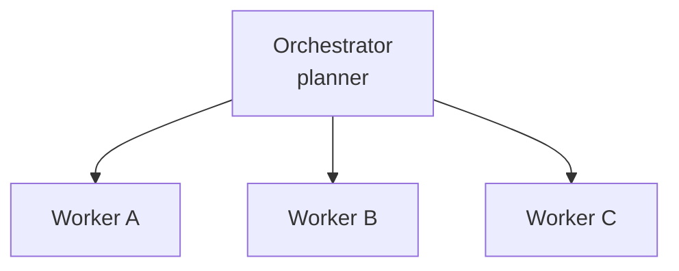
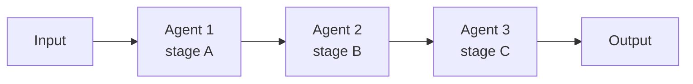
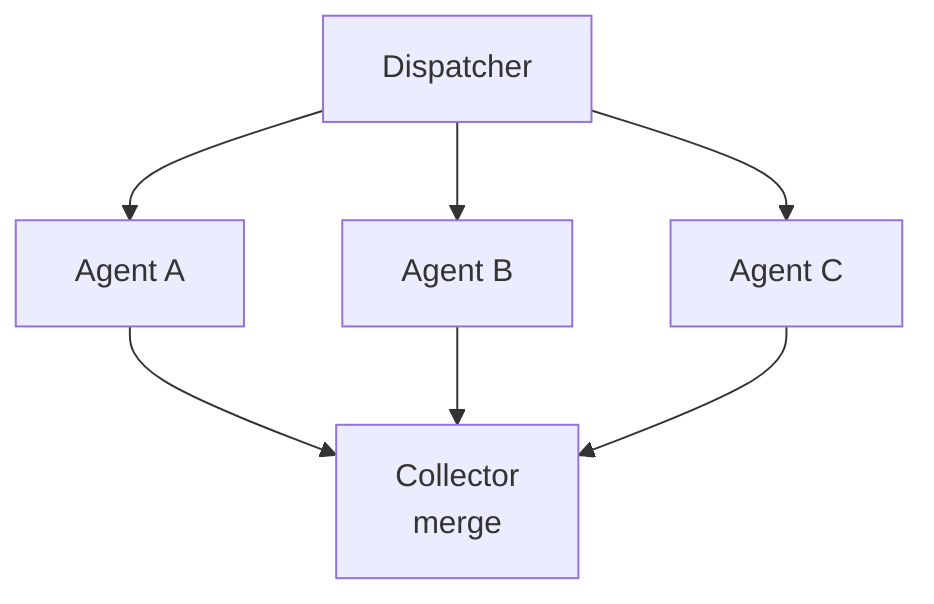
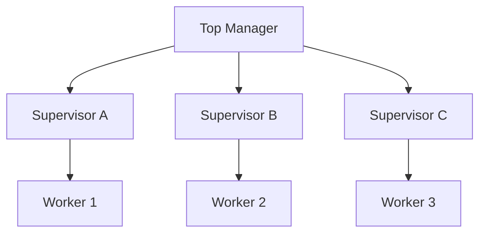
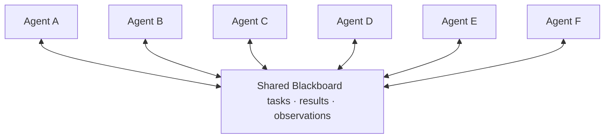
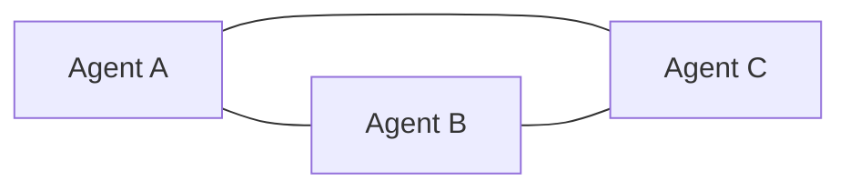

# Multi-Agent Orchestration Patterns: A Practical Guide

> Источник: <https://www.glukhov.org/ai-systems/architecture/multi-agent-orchestration-patterns/>
Single-agent AI systems peaked in 2025 — you gave one LLM a prompt, some tools, and a goal, and it did reasonably well on bounded tasks.

In 2026, multi-agent systems have moved from research demos to production infrastructure. Gartner reports a 1,445% increase in multi-agent system inquiries from Q1 2024 to Q2 2025, while Salesforce’s 2026 Connectivity Benchmark Report found organizations use an average of 12 agents, projected to grow 67% within two years. The [AI Systems cluster](https://www.glukhov.org/ai-systems/ "Build self-hosted AI systems with OpenClaw, Hermes, RAG, and local LLM infrastructure.") covers the full stack these systems operate on — from inference and memory to routing and observability.

One concrete production workload that leans on the orchestrator-worker and hierarchical patterns described here is Deep Research: a coordinator decomposes a question and independent subagents investigate pieces of it before results are synthesized. [Self-Hosted Deep Research Systems: 12 Tools Compared](https://www.glukhov.org/ai-systems/comparisons/deep-research-with-ai/ "Compare 12 self-hosted Deep Research systems: GPT Researcher, Onyx, Open WebUI, Khoj, Vane and more. Architectures, local LLM, RAG, licenses.") walks through DeerFlow, Open Deep Research, and ten other systems that implement this planner-plus-subagent shape (or its recursive and evidence-gap-driven alternatives) for research specifically.

But here’s what’s less discussed: **40% of multi-agent pilots fail within six months of production deployment**. The failure isn’t that multi-agent systems don’t work. The failure is that teams pick the wrong orchestration pattern for their problem — or pick the right one without understanding how it breaks.

This guide covers the orchestration patterns that hold up in production, the specific ways each one fails, and a decision framework for picking the right architecture.

---

## The Core Problem: Coordination Is Hard

When you move from a single AI agent to multiple agents working together, the first engineering question is: **how do they coordinate?**

The coordination model — the orchestration pattern — determines your system’s latency, fault tolerance, scalability ceiling, and debugging complexity. It is consistently the highest-impact architectural decision in multi-agent design, conditioning every subsequent implementation choice.

Every production multi-agent system maps to one of six canonical patterns, or a hybrid of two or more. The patterns emerge from distributed systems constraints: coordination cost, fault isolation, throughput requirements, and observability.

---

## Pattern 1: Orchestrator-Worker

### How It Works

Orchestrator-Worker is the **centralized hub-and-spoke** model of multi-agent coordination. A single orchestrator agent receives the task, decomposes it into subtasks, delegates each subtask to a specialist worker agent, and aggregates the results. Workers do not communicate directly with each other — all coordination flows through the orchestrator, which holds the full plan and decision-making authority.

### When to Use It

- Cross-functional workflows with clear task decomposition
- Triage and routing scenarios (customer support, incident classification)
- Workloads where a single accountability point is required
- Tasks where the orchestrator can use a capable model while workers use cheaper, task-specific models

**Real-world example:** Salesforce Agentforce 2.0 uses orchestrator-worker to decompose customer inquiries into research, draft, and review stages.

### How It Fails

**Single point of failure.** The orchestrator is both a bottleneck and a failure point. If the orchestrator’s LLM call takes 3 seconds and you have 20 workers waiting for assignments, your decomposition throughput ceiling is roughly 6.7 tasks per second. If the orchestrator misclassifies a task, the wrong worker gets it — and misclassification rates compound at scale.

**Context overflow.** The orchestrator accumulates context from all workers. At 4+ workers, the orchestrator frequently exceeds context limits because it holds the full conversation history for every worker interaction simultaneously.

**Cost explosion.** Workflows that cost $0.50 in testing can hit $50,000/month at 100K executions. The orchestrator makes multiple LLM calls for decomposition and aggregation on top of every worker call. At scale, the overhead dominates the worker cost.

### Mitigations

- Set explicit interface contracts between orchestrator and workers
- Require structured outputs from workers (JSON schemas, typed responses)
- Bound sub-task budgets (token limits, step limits) to prevent runaway costs
- Consider a hierarchical variant (see Pattern 4) when worker count exceeds 5

---

## Pattern 2: Sequential Pipeline

### How It Works

Sequential Pipeline is the **linear chain with shared state** — a predefined sequence of agents with deterministic order, where each stage transforms or enriches data and passes it to the next. There is no runtime branching; the execution order is fixed at design time, making the pattern highly predictable but inflexible.

### When to Use It

- Document processing workflows (ingest → extract → validate → output)
- Content generation pipelines (research → draft → edit → publish)
- Compliance verification (generate → check → revise → approve)
- Data enrichment and ETL workflows

**Real-world example:** Microsoft Azure law firm workflow uses sequential pipelines for contract generation: draft → review → redline → final.

### How It Fails

**Error propagation.** Bad output in stage 1 cascades downstream with no backtracking. A hallucination in the research stage produces a flawed draft, which the editor polishes into a confident but incorrect final output.

**Coordination overhead.** A 4-agent pipeline adds approximately 950ms of coordination overhead versus 500ms of processing time. You’re paying 3x for the same result if specialization isn’t required. Token consumption compounds: 29,000 tokens across a 4-agent pipeline versus 10,000 for a single agent doing the same work.

**No conditional branching.** The pipeline cannot adapt based on intermediate results. If stage 2 discovers the input is malformed, it has no mechanism to signal stage 1 to retry — it must either fail or produce degraded output.

### Mitigations

- Insert quality gates between stages (lightweight validation agents that check output before passing downstream)
- Add reprocessing loops for stages that can retry — durable workflow engines such as [Temporal](https://www.glukhov.org/app-architecture/integration-patterns/workflow-applications-temporal-in-go/ "Implementing Workflow Applications with Temporal in Go") handle retry semantics reliably
- Keep pipelines to 3-4 stages maximum; beyond that, consider orchestrator-worker for conditional branching

---

## Pattern 3: Fan-Out / Fan-In

### How It Works

Fan-Out / Fan-In is **parallel execution with aggregation**. A dispatcher routes work to multiple agents running simultaneously, then a collector aggregates their results via voting, weighted merging, or LLM synthesis. Agents operate independently throughout execution and do not communicate with each other — the only shared boundary is the collector.

### When to Use It

- Multi-perspective analysis where diverse viewpoints are valuable
- Concurrent code review (multiple reviewers in parallel)
- 4+ independent tasks that can be decomposed upfront
- Workloads where wall-clock time matters more than token efficiency

**Key metric:** Fan-out cuts wall-clock time by 75% compared to sequential execution. Four agents running in parallel complete in the time of one.

### How It Fails

**API rate limits.** Collective load exceeds capacity even if individual agents stay within limits. Five agents each making 10 requests per minute may exceed a 40 RPM limit that a single agent respects.

**Quadratic race conditions.** Shared state conflicts scale as N(N-1)/2. With 5 agents, that’s 10 potential conflicts. With 10 agents, it’s 45. State management becomes the dominant complexity.

**Aggregation hallucination.** LLM synthesis can invent consensus. If Agent A says “yes” and Agent B says “no,” the aggregator might produce “maybe” — a hallucinated middle ground that neither agent suggested. Requires explicit conflict resolution, not just summarization.

### Mitigations

- Use explicit voting mechanisms rather than freeform synthesis
- Implement rate limiting at the dispatcher level
- Maintain separate state per worker; merge at the collector
- Set a maximum agent count (5-8) to keep race conditions manageable

---

## Pattern 4: Hierarchical

### How It Works

Hierarchical is **tree-structured delegation with multiple levels** — a top-level manager delegates to mid-level supervisors, which delegate to leaf-level workers. Each level adds a layer of abstraction: strategy at the top, tactics in the middle, and execution at the leaves. Context windows are managed at each level independently, so no single agent needs to hold the entire problem in context.

### When to Use It

- Complex multi-domain enterprise tasks requiring 20+ agents
- Large-scale codebase auditing where different modules need different specialists
- Massive document processing (thousands of documents across multiple categories)
- Tasks where no single agent’s context window can hold the full problem

**Key advantage:** Hierarchical systems scale logarithmically. Each manager handles a bounded number of subordinates, so adding workers doesn’t linearly increase coordination overhead.

### How It Fails

**Latency accumulation.** Each level adds latency. A 3-level hierarchy requires at least 6-12 seconds minimum, accumulating per level. The top manager waits for all supervisors, who wait for all workers.

**Information loss.** Summarization between levels is lossy. A supervisor summarizes worker output for the top manager, losing details that might be critical for the final decision.

**Branch failure isolation.** A failure in one branch doesn’t propagate to others — which is good for fault tolerance but bad for consistency. Different branches might reach contradictory conclusions that the top manager cannot resolve.

### Mitigations

- Set explicit summarization requirements for each level
- Implement cross-branch validation at the top manager
- Keep hierarchy depth to 2-3 levels maximum
- Use structured outputs at every level to reduce information loss

---

## Pattern 5: Swarm

### How It Works

Swarm is **decentralized emergent coordination with no central authority**. Autonomous agents make local decisions based on shared state (a blackboard) or environment signals, with no orchestrator directing the flow. Agents discover available tasks, claim them, and publish results back to the shared space. Coordination is emergent — the system self-organizes around available work, similar to how bees navigate to a new hive without a central coordinator.

### When to Use It

- Research flows where the optimal search path is unknown
- Competitive intelligence gathering across multiple sources
- Large-scale web scraping with dynamic target discovery
- Parallel hypothesis exploration in scientific or analytical domains

**Key advantage:** A swarm of 50 research agents can explore 50 hypotheses in parallel without any central coordinator planning the search. The system self-organizes around available work.

### How It Fails

**Debugging nightmare.** Without a central control flow, tracing failures requires distributed tracing and blackboard replay. You cannot follow a single execution path — you must reconstruct the emergent behavior from logs.

**No transactional guarantees.** Swarm patterns cannot enforce strict ordering or transactional consistency. If you need Agent A to complete before Agent B starts, a swarm is the wrong pattern.

**Termination conditions.** How does the swarm know when to stop? Without explicit termination criteria, agents may continue indefinitely, consuming compute and generating diminishing returns.

### Mitigations

- Implement explicit termination conditions (time-based, result-count-based, or convergence-based)
- Use a blackboard with versioned entries to track state changes
- Add a monitoring agent that observes swarm behavior and can intervene
- Set agent-level budgets (maximum steps, maximum tokens) to prevent runaway execution — [Kanban-style dispatchers](https://www.glukhov.org/ai-systems/hermes/kanban-in-hermes/ "Kanban in Hermes Agent for Self Hosted LLM Workflows") provide practical rate-limit and concurrency patterns for self-hosted swarm deployments

---

## Pattern 6: Mesh

### How It Works

Mesh is **direct peer-to-peer communication with persistent connections** — agents communicate with each other through explicit, predefined channels rather than through any central hub. The communication graph is typically defined at deployment time, so Agent A knows it needs Agent B for database queries and Agent C for authentication logic. When those peers span separate services, teams, or vendors, the transport layer changes; see [Implementing patterns when agents cross boundaries](/ai-systems/architecture/multi-agent-orchestration-patterns/#implementing-patterns-when-agents-cross-boundaries) below.

### When to Use It

- Collaborative reasoning where agents need to share intermediate state
- Multi-agent coding systems (planner ↔ coder ↔ tester loops)
- Iterative artifact refinement where multiple specialists contribute
- Negotiation scenarios where agents represent different stakeholders

**Key advantage:** Ideal for iterative refinement. Agents can pass partial results back and forth, building on each other’s work without a central aggregator.

### How It Fails

**Combinatorial explosion.** Connection count scales as N(N-1)/2. With 3 agents, that’s 3 connections. With 8 agents, it’s 28. Best limited to 3-8 tightly coupled agents.

**Circular dependencies.** Agent A calls Agent B, which calls Agent C, which calls Agent A. Without cycle detection, mesh patterns can enter infinite loops.

**Debugging complexity.** Non-deterministic routing makes tracing failures nearly impossible. When the output is wrong, you need to reconstruct which agents communicated with which, in what order.

### Mitigations

- Define the communication graph at deployment time (not runtime)
- Implement cycle detection with maximum hop limits
- Use message passing with explicit acknowledgment
- Add a [circuit breaker](https://www.glukhov.org/app-architecture/integration-patterns/circuit-breaker-pattern-in-go/ "Implement the circuit breaker pattern in Go with gobreaker, context timeouts, retries, fallbacks, and production-ready configuration for microservices.") that terminates communication chains after N hops

---

## Implementing patterns when agents cross boundaries

Choosing an orchestration topology and choosing how agents communicate are separate decisions. The six patterns above describe **how work flows** — who delegates to whom, whether stages run in parallel, whether peers talk directly. They do not prescribe whether those agents live in one Python process, one Kubernetes cluster, or three vendor SaaS products.

In-process multi-agent systems — LangGraph graphs, CrewAI crews, AutoGen group chats in a single repo — keep coordination inside one runtime. Message passing is function calls or shared state. You get fast iteration, simple debugging, and no network boundary to secure. That is the right default until you have a concrete reason to split agents into independently deployable services.

You need a wire protocol at the boundary when agents are owned by different teams, run on different frameworks, or must be discoverable without redeploying the caller. That is where [A2A vs MCP: Do AI Agents Really Need Both Protocols?](https://www.glukhov.org/ai-systems/mcp/a2a-vs-mcp-ai-agent-protocols/ "A practical comparison of A2A and MCP for AI agent systems.") becomes the decision point: standardized discovery via Agent Cards, task lifecycle, and artifact exchange between services that do not share memory, plus a framework for when that overhead is worth it versus staying in-process with MCP alone.

### Mapping patterns to deployment

The topology you pick still matters once agents are separate services. Not every pattern maps cleanly to cross-boundary A2A; some stay internal by nature.

| Pattern | Same runtime / framework | Cross-boundary (A2A) |
| --- | --- | --- |
| Orchestrator-Worker | In-process delegation via graph edges | Primary assistant delegates to specialist Agent Cards |
| Sequential Pipeline | Stages wired in one runtime graph | Rare — stages are usually co-located for latency |
| Fan-Out / Fan-In | Parallel workers under one orchestrator | Uncommon unless workers are already separate services |
| Hierarchical | Nested graphs in one process | Department-level agents as A2A peers under a top orchestrator |
| Swarm | Shared blackboard, one process | Unusual cross-boundary — shared state and governance are harder |
| Mesh | Custom graph edges in-process | **Primary A2A use case** — peers across teams, vendors, or frameworks |

Orchestrator-Worker and Hierarchical are the most common cross-boundary shapes in production: a user-facing orchestrator discovers specialists and tracks delegated tasks. Mesh becomes the natural fit when no single hub should own routing — for example, a coding agent that talks directly to a test agent and a security review agent owned by different teams.

### Mesh across ownership boundaries

When mesh participants span ownership boundaries, in-process graph edges become A2A task sends. Each peer publishes an [Agent Card](https://www.glukhov.org/ai-systems/architecture/a2a-protocol-explained/ "A practical guide to the A2A Protocol for AI agents.") describing its skills, auth requirements, and endpoint. Callers discover capabilities at runtime or from a curated registry rather than hard-coding URLs in application config.

Two deployment styles compete here. **Predefined graph at deploy time** keeps the mesh predictable: Agent A is configured to call Agent B and C, and A2A handles the wire format and task state. **Runtime discovery** lets orchestrators pick specialists from a registry when skills or vendors change, at the cost of more moving parts and stricter governance. Most teams start with a predefined graph and add discovery when the agent catalog grows beyond what config files can manage.

A2A does not remove the mesh failure modes from the section above. Combinatorial connection growth, circular handoffs, and opaque debugging still apply — they just happen over HTTP instead of in-memory queues. Keep cycle detection and maximum hop limits in the orchestrator or gateway. Long-running delegated work should use task IDs and async follow-up rather than blocking each hop; [A2A Streaming and Async Tasks for Long-Running Agent Workflows](https://www.glukhov.org/ai-systems/architecture/a2a-streaming-async-task-lifecycle/ "How to design A2A protocol streaming, async tasks, push notifications, and long-running agent workflows with SSE, polling, HITL states, and production observability.") covers SSE, push webhooks, and `input_required` pauses at that boundary.

Identity, scoped authorization, and audit trails become mandatory once peers are separate services. [A2A and MCP Agent Security: Identity, Delegation, and Audit Trails](https://www.glukhov.org/llm-architecture/guardrails/a2a-mcp-agent-security/ "Secure A2A and MCP agent systems with identity, auth, delegation controls, gateways, registries, audit trails, and a production checklist for multi-agent deployments.") covers gateways, delegation tokens, and what to log at each hop.

### Failure modes specific to cross-boundary agents

Three problems show up often when orchestration patterns leave the process boundary:

**Circular delegation across services.** Agent A on team one delegates to Agent B on team two, which delegates back to A or to a third agent that eventually calls A. The mitigations from the Mesh section — hop limits, cycle detection, [circuit breakers](https://www.glukhov.org/app-architecture/integration-patterns/circuit-breaker-pattern-in-go/ "Implement the circuit breaker pattern in Go with gobreaker, context timeouts, retries, fallbacks, and production-ready configuration for microservices.") — must be enforced at the gateway or orchestrator, not assumed away because A2A provides structured messages.

**Hidden cost explosion across delegation chains.** Each A2A hop may invoke an LLM, tools, and further sub-delegation. A topology that looked cheap in-process can multiply token spend when every specialist is a billed API call. Track cost per task ID and per hop; the [Cost Control](/ai-systems/architecture/multi-agent-orchestration-patterns/#cost-control-the-hidden-multiplier) section above applies directly to cross-boundary chains.

**Unclear ownership of the final answer.** When three agents on two vendors contribute artifacts, users and auditors need to know which agent (and which underlying model and tools) produced the output they see. Propagate parent task IDs, log delegation chains, and treat artifact provenance as a first-class observability field — not an afterthought once something goes wrong.

### Where to go next

This section bridges orchestration topology to protocol choice. For depth on each layer:

- [What Is the A2A Protocol? Agent Cards and Tasks Explained](https://www.glukhov.org/ai-systems/architecture/a2a-protocol-explained/ "A practical guide to the A2A Protocol for AI agents.") — Agent Cards, task lifecycle, messages, parts, and artifacts
- [A2A vs MCP: Do AI Agents Really Need Both Protocols?](https://www.glukhov.org/ai-systems/mcp/a2a-vs-mcp-ai-agent-protocols/ "A practical comparison of A2A and MCP for AI agent systems.") — the A2A outside, MCP inside deployment pattern
- [A2A Streaming and Async Tasks for Long-Running Agent Workflows](https://www.glukhov.org/ai-systems/architecture/a2a-streaming-async-task-lifecycle/ "How to design A2A protocol streaming, async tasks, push notifications, and long-running agent workflows.") — SSE, push, polling, and human-in-the-loop pauses across service boundaries
- [A2A and MCP Agent Security: Identity, Delegation, and Audit Trails](https://www.glukhov.org/llm-architecture/guardrails/a2a-mcp-agent-security/ "Secure A2A and MCP agent systems with identity, auth, delegation controls, gateways, registries, audit trails, and a production checklist for multi-agent deployments.") — identity, gateways, delegation scope, and audit design

---

## The Decision Framework

> Start with the simplest pattern that fits your problem. Most teams over-architect toward multi-agent topologies long before the single-agent approach has been genuinely exhausted.

### Step 1: Characterize Your Problem

| Problem Characteristic | Recommended Pattern |
| --- | --- |
| Known task decomposition, clear specialists | **Orchestrator-Worker** |
| Fixed sequence, no branching needed | **Sequential Pipeline** |
| Independent subtasks, need parallelism | **Fan-Out / Fan-In** |
| Complex, multi-domain, 20+ agents | **Hierarchical** |
| Exploration, unknown search space | **Swarm** |
| Collaborative refinement, peer communication | **Mesh** |

### Step 2: Estimate Your Constraints

| Constraint | Pattern to Avoid |
| --- | --- |
| Low latency (< 2 seconds) | Hierarchical, Mesh |
| Strict ordering required | Swarm, Fan-Out |
| Single point of accountability | Swarm, Mesh |
| High fault tolerance needed | Orchestrator-Worker, Sequential |
| Budget-constrained | Fan-Out (parallel = more tokens) |
| Complex debugging required | Swarm, Mesh |

### Step 3: Start Single-Agent

The canonical agent loop — a single agent with tools, reasoning, and iteration — is still the right default for general-purpose agents. [AI Assistant Architecture](https://www.glukhov.org/ai-systems/architecture/ai-assistant-architecture/ "AI Assistant Architecture: LLM, Memory, Tools, Routing, Observability") covers the five-layer foundation that single-agent systems build on, and it is worth mastering that foundation before layering in multi-agent coordination. Note that multi-agent systems are also fundamentally different from multi-model routing; for the latter, see [Multi-Model System Design](https://www.glukhov.org/llm-architecture/model-routing/multi-model-system-design/ "Multi-Model System Design: When One Model Isn't Enough"), which covers sequential, parallel, and ensemble patterns applied to model selection rather than agent coordination.

Escalate to multi-agent only when measurement says you must:

- Single agent context window is insufficient
- Task requires genuine parallelism (wall-clock time matters)
- Specialization provides measurable quality improvement
- Cost of single-agent approach exceeds multi-agent overhead

A lighter-weight version of this escalation already ships inside individual coding tools: [Claude Code subagents](https://www.glukhov.org/ai-devtools/claude-code/claude-code-subagents/ "How Claude Code subagents work: isolated context, model routing, .claude/agents setup, the Explore-Plan-Execute workflow, and mistakes to avoid.") delegate isolated, context-heavy tasks to a scoped sub-agent within one tool, without the cross-process coordination cost of the patterns above — worth exhausting before reaching for a full orchestration framework.

For background and proactive agent work — scheduling, queue-based execution, durable polling loops — see [Polling Agents in AI Assistants: 11 Implementation Patterns](https://www.glukhov.org/ai-systems/architecture/polling-agents-ai-assistants-implementation-patterns/ "Polling Agents in AI Assistants: 11 Implementation Patterns"), which complements multi-agent orchestration patterns with the scheduling layer underneath them.

---

## Failure Modes: The MAST Taxonomy

Research from NeurIPS 2025 (MAST — Multi-Agent System Failure Taxonomy) analyzed 1,600+ execution traces across seven popular multi-agent frameworks. Failures distribute across three root categories:

### 1. Specification Ambiguity (33% of failures)

Agents misinterpret roles, duplicate work, or skip verification because their instructions are underspecified.

**Fix:** Use specification schemas. Define explicit role descriptions, task boundaries, and output formats for every agent. Structured schemas (JSON, Pydantic models) beat natural language instructions.

### 2. Coordination Breakdowns (33% of failures)

Agents communicate using unstructured protocols, leading to message loss, race conditions, and circular handoffs.

**Fix:** Implement structured coordination protocols. Use typed message passing, acknowledgment mechanisms, and explicit termination conditions.

### 3. Verification Gaps (33% of failures)

No independent validation of agent outputs. Agents trust each other’s output without verification, allowing errors to propagate.

**Fix:** Add independent validation agents. Use a separate model or verification step to validate outputs before accepting them. This is the maker-checker pattern.

---

## Cost Control: The Hidden Multiplier

Multi-agent systems have a cost structure that scales non-linearly:

| Pattern | Cost Multiplier (vs single agent) |
| --- | --- |
| Orchestrator-Worker | 2-3x (orchestrator + workers) |
| Sequential Pipeline | 3-4x (each stage pays full token cost) |
| Fan-Out / Fan-In | 4-5x (all agents run fully) |
| Hierarchical | 3-5x (depends on depth) |
| Swarm | 2-10x (depends on convergence) |
| Mesh | 3-6x (depends on iteration count) |

**Cost optimization strategies:**

1. **Use cheaper models for workers.** The orchestrator needs reasoning capability; workers can use smaller, faster models.
2. **Bound execution budgets.** Set maximum tokens, maximum steps, and maximum time per agent.
3. **Implement early termination.** Stop agents that have clearly failed or succeeded.
4. **Cache shared context.** Use prefix caching (vLLM, SGLang RadixAttention) to avoid recomputing shared system prompts.
5. **Monitor per-agent cost.** Track token consumption per agent, not just total cost. Identify the most expensive agents and optimize first.

For a deeper treatment of token optimization strategies — prompt compression, caching, batching, and smart model selection — see [Reduce LLM Costs: Token Optimization Strategies](https://www.glukhov.org/llm-performance/cost-effective-llm-applications/ "Reduce LLM Costs: Token Optimization Strategies"). The techniques apply equally to individual agent calls within a multi-agent system.

---

## Observability: Seeing Inside the Black Box

Multi-agent systems fail in ways that make traditional debugging inadequate. When multiple agents coordinate, issues propagate across agent boundaries, execution paths become unpredictable, and identifying root causes requires visibility into distributed workflows. [Observability for LLM Systems](https://www.glukhov.org/observability/observability-for-llm-systems/ "Observability for LLM Systems: Metrics, Traces, Logs, and Testing in Production") covers the full production observability stack — metrics, distributed tracing, logs, SLOs, and tool comparisons — that multi-agent systems rely on. For instrumenting vLLM and llama.cpp inference endpoints with Prometheus and Grafana, see [Monitor LLM Inference in Production](https://www.glukhov.org/observability/monitoring-llm-inference-prometheus-grafana/ "Monitor LLM Inference in Production (2026): Prometheus and Grafana for vLLM, TGI, llama.cpp").

### Essential Observability Components

**1. Distributed Tracing**

Capture the complete interaction graph across all agents. Traditional tools show you whether components are running, but multi-agent debugging requires understanding how components interact and where coordination breaks down.

Key spans to trace:

- Orchestrator decomposition step
- Each worker’s execution
- Aggregation step
- Cross-agent communication (mesh/swarm)

**2. Blackboard Replay**

For swarm and mesh patterns, maintain a versioned blackboard that can be replayed. This allows you to reconstruct the emergent behavior that led to a failure.

**3. Cost Attribution**

Track token consumption per agent, per step. Identify which agents are consuming disproportionate resources.

**4. Convergence Monitoring**

For swarm and mesh patterns, monitor whether the system is converging or diverging. Set alerts for:

- Agent count exceeding expected bounds
- Iteration count exceeding thresholds
- Output quality degrading over time

---

## Framework Support Matrix

| Pattern | LangGraph | AutoGen | CrewAI | OpenAI Agents SDK |
| --- | --- | --- | --- | --- |
| Orchestrator-Worker | ✅ Native | ✅ Native | ✅ Native | ✅ Native |
| Sequential Pipeline | ✅ Graph edges | ✅ Sequential | ✅ Agent chains | ✅ Handoff |
| Fan-Out / Fan-In | ✅ Superstep | ✅ Group chat | ✅ Crew | ✅ Parallel |
| Hierarchical | ✅ Nested graphs | ✅ Hierarchical | ❌ Limited | ❌ Limited |
| Swarm | ❌ Limited | ✅ Swarm | ❌ No | ❌ No |
| Mesh | ✅ Custom graph | ✅ Group chat | ❌ No | ❌ No |

---

## Putting It Together: A Production Example

Real-world systems rarely map cleanly to a single pattern — most production deployments combine two or three approaches, each handling the part of the workflow it is best suited for. Infrastructure patterns like [Go Microservices for AI/ML Orchestration](https://www.glukhov.org/app-architecture/integration-patterns/go-microservices-for-ai-ml-orchestration-patterns/ "Go Microservices for AI/ML Orchestration") describe the service-level choreography and saga patterns that underpin these hybrid architectures at scale.

Consider a customer support system that handles technical inquiries:

1. **Triage (Orchestrator-Worker):** Incoming ticket → orchestrator classifies → routes to specialist
2. **Research (Fan-Out):** Specialist agent runs parallel queries (knowledge base, ticket history, product docs)
3. **Draft (Sequential):** Research → draft response → quality check
4. **Escalation (Hierarchical):** If quality check fails, escalate to senior agent → human review

This hybrid approach uses four patterns because no single pattern handles the full workflow optimally. The key insight: **compose patterns, don’t force one pattern to do everything.**

---

## Key Takeaways

1. **Start simple.** Single-agent with tools is the default. Escalate to multi-agent only when measurement demands it.
2. **Match pattern to problem.** Orchestrator-worker for decomposition, pipeline for fixed sequences, fan-out for parallelism, hierarchical for scale, swarm for exploration, mesh for collaboration.
3. **Expect failure modes.** Every pattern has specific ways it breaks. Design mitigations before you deploy.
4. **Cost scales non-linearly.** Multi-agent systems multiply token consumption. Budget for 2-5x the cost of a single agent.
5. **Observability is non-negotiable.** Without distributed tracing and cost attribution, you cannot debug or optimize multi-agent systems.
6. **Compose patterns.** Most production systems use 2-3 patterns combined. Don’t force a single pattern to handle everything.

The multi-agent landscape is maturing rapidly. The teams that succeed are those that understand the tradeoffs, pick patterns deliberately, and build observability from day one.

---

## Frequently Asked Questions

**What is multi-agent orchestration?**
Multi-agent orchestration is the coordination model that governs how multiple AI agents work together on a task. The pattern you choose — hub-and-spoke, pipeline, fan-out, hierarchical, swarm, or mesh — determines your system’s latency, fault tolerance, scalability ceiling, and debugging complexity. Each pattern makes different tradeoffs and breaks in different ways.

**Which multi-agent pattern is best for production AI systems?**
Most production systems start with orchestrator-worker. It provides clear accountability, debuggable control flow, and predictable costs. Escalate to hierarchical when worker count exceeds 5-8 and to fan-out when independent parallel tasks dominate the workload. Swarm and mesh remain niche patterns reserved for exploration workflows and tight peer collaboration respectively.

**Why do 40% of multi-agent pilots fail?**
The three root causes according to the MAST taxonomy from NeurIPS 2025 are specification ambiguity (agents misinterpret roles or skip verification steps), coordination breakdowns (unstructured messaging leads to message loss and circular handoffs), and verification gaps (no independent validation of agent outputs, allowing errors to propagate unchecked). Each category accounts for roughly a third of all failures across 1,600+ analyzed execution traces.

**How much more does a multi-agent system cost than a single agent?**
Expect 2 to 10 times the token cost depending on the pattern. Orchestrator-worker is cheapest at 2-3x. Fan-out and swarm are most expensive at 4-10x because agents run in parallel and each consumes a full token budget independently. These multipliers compound at scale — a workflow costing $0.50 in testing can reach $50,000 per month at 100K executions.

**How do you debug a multi-agent system when something goes wrong?**
Start with distributed tracing — one trace per execution, with spans for each agent call, tool invocation, and aggregation step. For swarm and mesh patterns, implement blackboard replay so you can reconstruct the emergent behavior from logs. Per-agent cost attribution helps identify which agents are triggering cascading failures or runaway spend before they reach production scale.

**When do multi-agent patterns need A2A instead of in-process orchestration?**
Stay in-process when all agents share one runtime, repo, and team. Add A2A at the boundary when specialists are independently deployed, owned by different teams or vendors, or must be discovered via Agent Cards without redeploying the caller. Orchestrator-worker and mesh are the most common cross-boundary shapes; see [Implementing patterns when agents cross boundaries](/ai-systems/architecture/multi-agent-orchestration-patterns/#implementing-patterns-when-agents-cross-boundaries) for the full mapping table.
